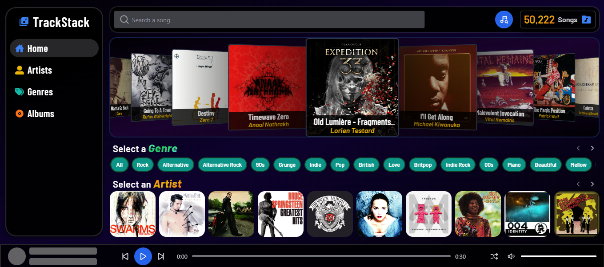

# 🎵 TrackStack

Do you want to find a new **banger**? TrackStack is an **AI-powered music recommendation web app** that builds vectors from **song metadata** (energy, danceability, mood, and more), lets you tune the weights that matter to you, and recommends tracks from a catalogue of over **50,000 songs**. Every recommendation comes with a **30-second preview** so you can listen before jumping to Spotify.

🔗 **[Live Project](https://trackstack-c9rh.onrender.com/)**

<p align="center">
    
</p>

---

## What it does

- 🎛️ **Personalized recommendations** — set genre, energy, danceability, mood, sentiment, tempo, and more; the app turns them into a weighted vector and finds the closest songs with **pgvector cosine similarity**.
- 🤖 **AI recommendations in streaming** — Google Gemini describes your selection while the results arrive over a **GraphQL subscription** (WebSocket).
- 🔎 **Search across songs, artists, and albums** — typo-tolerant and accent-insensitive search powered entirely by **PostgreSQL** (`pg_trgm` + `unaccent`), with trigram indexes and SQL ranking functions.
- ▶️ **Built-in player** — 30-second previews, random/next/previous track controls, and volume control.
- 🎨 **Browse by artist, album, or genre** — dedicated pages with infinite scrolling and detail views, including a Spotify link for full tracks.

## Stack

| Workspace | Stack | Docs |
|-----------|-------|------|
| **Backend** | NestJS 11, GraphQL code-first with Apollo Server 5, `graphql-ws` subscriptions, Sequelize 6, PostgreSQL + `pgvector`, Prisma 7 for migrations, Google GenAI (Gemini) | [backend/README.md](./backend/README.md) |
| **Frontend** | React 19, Vite 6, TypeScript, Chakra UI 3, Redux Toolkit, Apollo Client 3, React Router 7, Zod 4 | [frontend/README.md](./frontend/README.md) |
| **Schemas** | Shared Zod 4 contracts (`@trackstack/schemas`) | — |
| **E2E** | Playwright across Chromium, Firefox, and WebKit | — |

Unit tests for the backend and frontend run with Vitest. Delivery is handled by GitHub Actions CI, Render CD, and a scheduled health check.

## Quick start

### Try the live version

1. Open [TrackStack](https://trackstack-c9rh.onrender.com/).
2. Click the **beam note** button in the top-right corner.
3. Pick your genres and adjust the sliders and switches.
4. Press **Send Data** and listen to the results.

### Run locally

Requirements: Node.js 20+, **pnpm** (the version is pinned in `package.json`), PostgreSQL with `pgvector`, and a Google GenAI API key for the AI messages.

```bash
git clone https://github.com/Raghart/TrackStack.git
cd TrackStack
pnpm install

# Backend (NestJS + GraphQL) on http://localhost:3000
pnpm run dev:backend

# Frontend (Vite) on http://localhost:5173
pnpm run dev:frontend
```

The end-to-end suite is the [`./e2e`](./e2e) workspace, driven by Playwright against the built app. It requires a running backend and database; run it from the repository root with `pnpm run test:e2e` (install browsers once with `pnpm --filter ./e2e exec playwright install`).

The full variable list and every available command live in the backend README:

- 📖 **[Backend README](./backend/README.md)** — architecture, GraphQL API, database, environment variables, and tests.
- 📖 **[Frontend README](./frontend/README.md)** — features, routes, state management, Apollo setup, and usage screenshots.

## Repository layout

```text
TrackStack/
├── backend/          # NestJS + GraphQL API, Sequelize models, Prisma migrations
├── frontend/         # React SPA (Vite), built into backend/public
├── schemas/          # Shared Zod schemas (@trackstack/schemas)
├── e2e/              # Playwright end-to-end tests (pnpm workspace)
├── assets/           # Screenshots used by the READMEs
└── .github/workflows # CI, CD, and health check
```

The backend also serves the production frontend build, so `pnpm run build:frontend && pnpm run build:backend` produces a single deployable app.