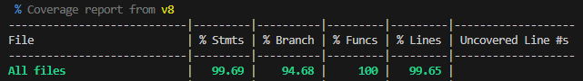

# TrackStack — Backend

NestJS + GraphQL API for [TrackStack](../README.md). It serves the song catalogue, the recommendation engine, the AI streaming endpoint, and the production frontend build.

- **Framework:** NestJS 11 on Express 5
- **API:** GraphQL code-first with Apollo Server 5 (`@nestjs/graphql`, schema generated in memory)
- **Realtime:** GraphQL subscriptions over WebSocket with `graphql-ws`
- **Data:** Sequelize 6 over PostgreSQL, with `pgvector` for song embeddings
- **Migrations:** Prisma 7 (`database/`)
- **AI:** Google GenAI (Gemini) for streamed recommendation messages
- **Tests:** Vitest 5 + `unplugin-swc`

## How it works

```text
frontend ──HTTP──▶ /graphql ──▶ resolver ──▶ service ──▶ Sequelize ──▶ PostgreSQL
    │                              │
    └──WebSocket──▶ subscription ──┴──▶ Google GenAI (streaming)
```

Each domain (`songs`, `albums`, `artists`, `genres`, `song_artists`, `song_genres`, `song_details`, `search`) follows the same shape: a thin resolver receives the GraphQL arguments, the service owns the business logic and data access, and the DTOs declare the public GraphQL contract. Inputs are validated with guards and parsers from `src/types/`, database access is wrapped in `safeQuery`, and invalid pagination raises `InvalidPaginationException`.

### Recommendation flow

1. The frontend turns the user's sliders and switches into an 8-value vector: `danceability`, `energy`, `mode`, `speechiness`, `acousticness`, `instrumentalness`, `valence`, and `tempo`.
2. `getSongRecommendations(genres, userVector, limit)` calls the PostgreSQL function `search_songs_cosine_similarity(genres, userVector::vector, limit)`, which ranks songs by cosine distance.
3. In parallel, `aiResponse(genres, userVector)` opens a Gemini stream and yields each chunk as a GraphQL subscription event, so the message appears progressively in the UI.

### Search (migration in progress)

The search endpoint is moving from Elasticsearch to a PostgreSQL-only implementation. The database migrations already add `pg_trgm`, `unaccent`, GIN trigram indexes, and the `search_songs`, `search_artists`, and `search_albums` functions with exact/prefix/contains/fuzzy ranking. The current `SearchService` still returns empty arrays while the Sequelize implementation is being completed; the GraphQL contract (`multipleSearch`) already matches the frontend.

## GraphQL API

The schema is generated at runtime. With the backend running, open `http://localhost:3000/graphql` for the Apollo playground.

### Queries

| Query | Arguments | Returns |
| --- | --- | --- |
| `getDBLength` | — | Song count |
| `getLandpageSongs` | `limit = 20` | Random songs for the landing page |
| `getSongData` | `SongID` | Full song details (album, artists, genres, Spotify id) |
| `getRandomSong` | — | A random song |
| `getNextSong` | `songID` | Next song by id |
| `getPreviousSong` | `songID` | Previous song by id |
| `getSongRecommendations` | `genres`, `userVector`, `limit = 40` | Songs ordered by vector similarity |
| `getAllArtists` | `seed`, `page = 1`, `limit = 20` | Paginated artists |
| `getAllArtistSongs` | `artist` | Songs by artist |
| `getAlbums` | `seed`, `page = 1`, `limit = 20` | Paginated albums |
| `getAllAlbumSongs` | `album` | Songs in an album |
| `getAllGenres` | — | All genre names |
| `getAllGenreSongs` | `seed`, `genre`, `page = 1`, `limit = 20` | Songs in a genre |
| `multipleSearch` | `query` | Exact and fuzzy matches for songs, artists, and albums |

### Subscription

| Subscription | Arguments | Emits |
| --- | --- | --- |
| `aiResponse` | `genres`, `userVector` | Markdown chunks generated by Gemini |

## Project structure

```text
backend/
├── src/
│   ├── <domain>/             # module + resolver + service + specs
│   │   └── dto/              # @ObjectType / @Field GraphQL types
│   ├── search/               # multipleSearch resolver/service and SQL search helpers
│   ├── types/                # attribute types, guards, parsers, shared types
│   ├── utils/                # safeQuery, pagination, ranking helpers
│   ├── app.module.ts         # Sequelize, GraphQL, ServeStatic wiring
│   └── main.ts               # bootstrap, CORS, port
├── models/<domain>/          # Sequelize models
├── test/                     # fixtures and shared constants for unit tests
├── database/                 # Prisma schema, migrations, and database notes
├── public/                   # generated frontend build served by Nest
├── dist/                     # compiled output
└── coverage/                 # generated test coverage
```

## Environment variables

Create `backend/.env` (the backend loads it on startup). A generated frontend build is served from `public/`, so the same process can host the API and the SPA.

| Variable | Required | Purpose |
| --- | --- | --- |
| `DB_URL` | Yes | PostgreSQL connection string |
| `DB_PORT` | Yes | PostgreSQL port |
| `API_KEY` | Yes | Google GenAI API key |
| `AI_MODEL` | Yes | Gemini model name used for streamed messages |
| `URL_DOMAIN` | Yes | Allowed CORS origin (for local Vite: `http://localhost:5173`) |
| `PORT` | No | HTTP port (defaults to `3000`) |
| `LOCAL_PAGE_URL` | No | URL printed on startup |
| `LOCAL_GRAPHQL` | No | GraphQL URL printed on startup |

The Sequelize connection uses SSL with `rejectUnauthorized: false`, which works with hosted PostgreSQL providers such as Aiven. Prisma reads the same `backend/.env` through `database/prisma.config.ts`.

## Commands

From the repository root:

```bash
pnpm run dev:backend                 # NestJS in watch mode
pnpm run build:backend               # nest build -> backend/dist
pnpm run start:prod                  # run the compiled backend
pnpm run test:backend                # Vitest unit tests
```

Or target the package directly:

```bash
pnpm --filter ./backend run dev
pnpm --filter ./backend run build
pnpm --filter ./backend run lint
pnpm --filter ./backend run test
pnpm --filter ./backend run test:watch
pnpm --filter ./backend run test:cov
pnpm --filter ./backend run format
pnpm --filter ./backend run db:validate
pnpm --filter ./backend run db:status
pnpm --filter ./backend run db:migrate
pnpm --filter ./backend run db:generate
```

Run a single spec with `pnpm --filter ./backend run test -- src/songs/songs.service.spec.ts`.

## Database & Migrations

Prisma-managed PostgreSQL schema with pgvector support and custom fuzzy-search
functions (trigram + unaccent). See [docs/database.md](./docs/database.md)
for migration structure and schema change guidelines.

## Tests

Unit tests live next to the code (`src/<domain>/*.spec.ts`) and do not need PostgreSQL: models are mocked and the AI provider is replaced with a stub. Fixtures live in `test/data/` and shared assertions in `src/utils/expect*.ts`.

```bash
pnpm --filter ./backend run test -- src/songs/songs.service.spec.ts   # one spec
pnpm --filter ./backend run test:cov                                  # full suite + coverage
```

<p align="center">
    
</p>

## Production

`pnpm run build:frontend` writes the SPA into `backend/public`, and the backend serves it with `ServeStaticModule`. Deploying therefore means building both packages and running the compiled backend with the environment variables above. GitHub Actions runs lint, the security ESLint pass, and the unit tests on every pull request; the CD workflow triggers a Render deployment on `main`.

---

[← Back to the project README](../README.md) · [Frontend README →](../frontend/README.md)
