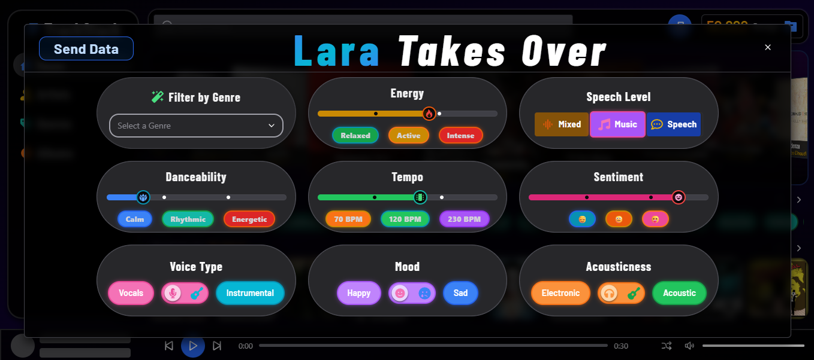
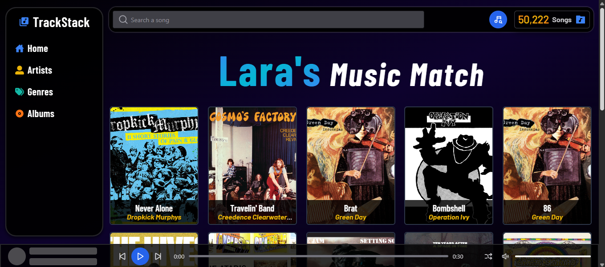
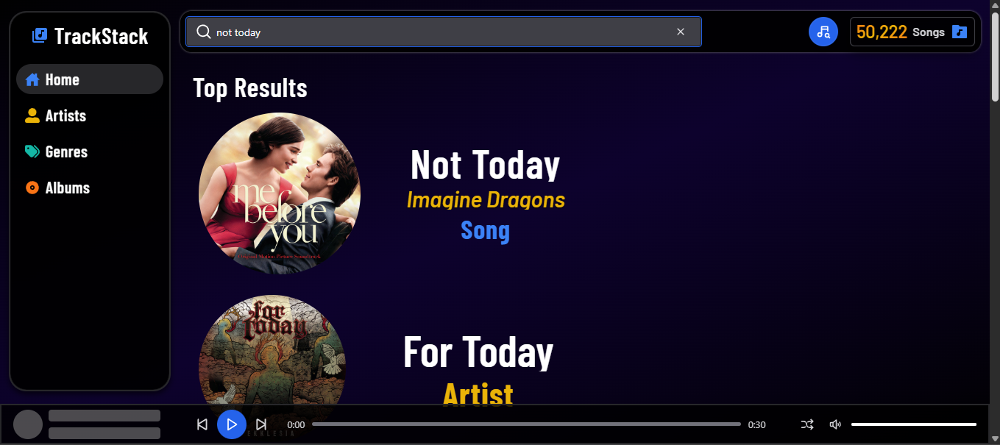
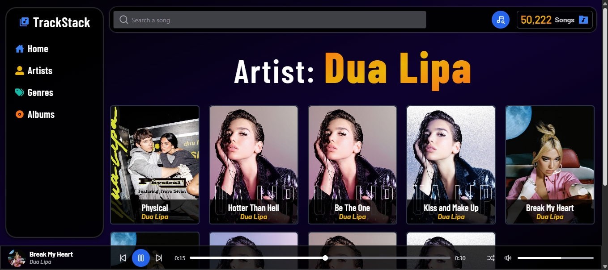
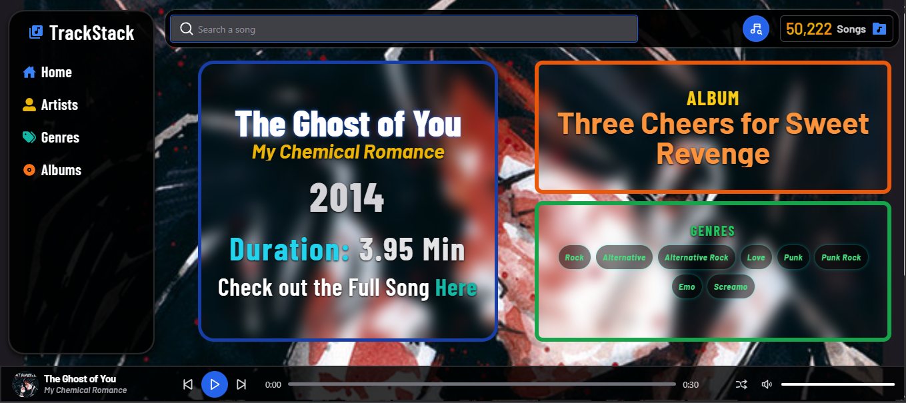
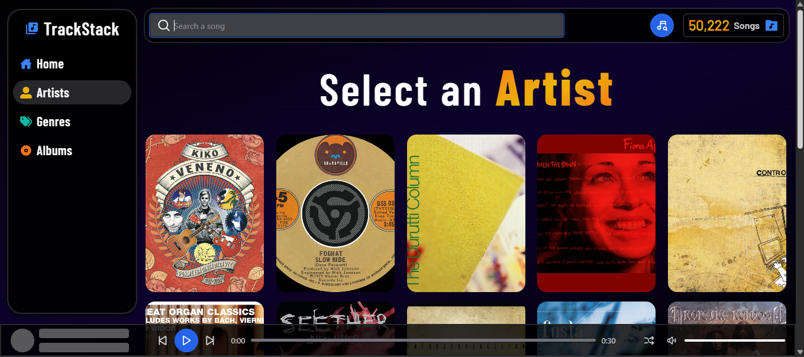
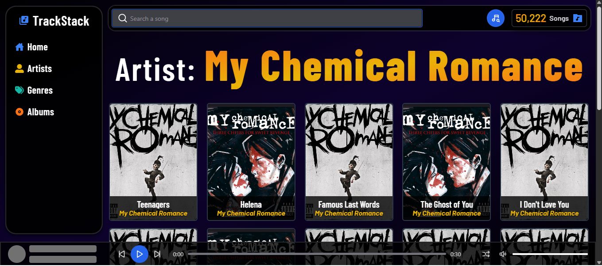
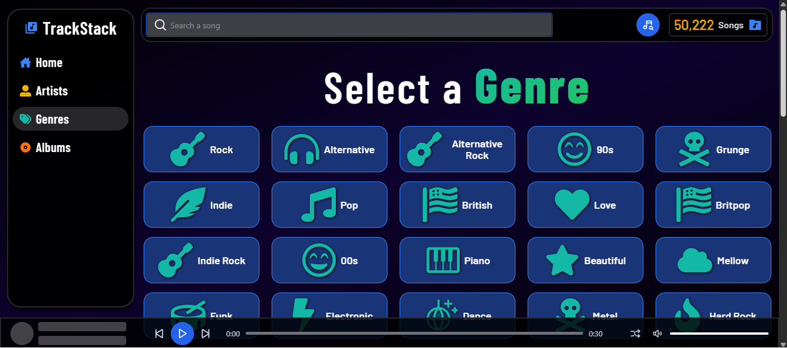
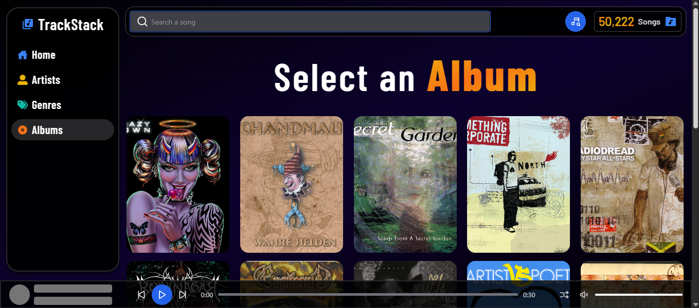
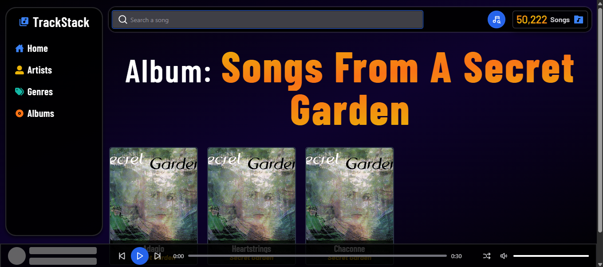

# TrackStack — Frontend

React single-page app for [TrackStack](../README.md). It provides the recommendation flow, the music player, and the browsing experience for songs, artists, albums, and genres.

- **React 19** + **TypeScript**
- **Vite 6** for the dev server and production build
- **Chakra UI 3** for the component system and responsive layout
- **Apollo Client 3** for GraphQL queries and WebSocket subscriptions
- **Redux Toolkit 2** for the player, search, and recommendation state
- **React Router 7** for client-side routing
- **Zod 4** for runtime validation

## Features

### Get personalized recommendations

1. Open the recommendation modal with the **beam note** button in the top-right corner.
2. Pick one or more genres and adjust the sliders and switches (energy, danceability, mood, sentiment, tempo, and more).
3. Press **Send Data**. The app builds a weighted vector, requests the matching songs, and streams an AI description of the selection.

<p align="center">
    
</p>

<p align="center">
    
</p>

### Search songs, artists, and albums

The search bar in the top navbar sends the query to `multipleSearch` and shows exact matches plus fuzzy results. While the backend search migration is in progress, the UI, GraphQL document, and result handling are already in place.

<p align="center">
    
</p>

### Listen to 30-second previews

Hover over a song cover and press play. The player at the bottom shows the current track and elapsed time, and includes random, previous, next, and volume controls.

<p align="center">
    
</p>

### Explore track details

Clicking a song title opens its detail page with artists, genres, duration, release year, album, and a link to Spotify.

<p align="center">
    
</p>

### Browse artists, genres, and albums

The left sidebar links to the artist, genre, and album catalogues. Each catalogue supports infinite scrolling, and every card opens the corresponding detail page.

<p align="center">
    
</p>

<p align="center">
    
</p>

<p align="center">
    
</p>

<p align="center">
    
</p>

<p align="center">
    
</p>

## Routes

| Route | Page |
| --- | --- |
| `/` | Landing page with a random song selection |
| `/songs/:songId` | Song details |
| `/recommendations` | Recommendation results and streamed AI message |
| `/artists` | Artist catalogue |
| `/artists/:artist` | Songs by artist |
| `/albums` | Album catalogue |
| `/albums/:album` | Songs in an album |
| `/genres` | Genre catalogue |
| `/genres/:genre` | Songs in a genre |
| `*` | Redirect to `/` |

`MainLayout` keeps the sidebar, search bar, and music player mounted across routes. When the search query is non-empty, it renders the search results instead of the routed page.

## Project structure

```text
frontend/
├── src/
│   ├── components/
│   │   ├── Landpage/                 # landing page, search bar, search results
│   │   ├── SongPath/                 # song details
│   │   ├── LaraRecommendationsPath/  # recommendation results and AI message
│   │   ├── GenrePath/GenreDetails/   # genre catalogue and genre songs
│   │   ├── ArtistPath/               # artist catalogue
│   │   ├── AlbumPath/DetailsPath/    # album catalogue and detail layout
│   │   ├── SongCard/                 # song cards and play overlay
│   │   ├── MainLayout/               # sidebar, top bar, player shell
│   │   ├── Pagination/               # pagination controls and helpers
│   │   ├── Utils/                    # hooks, formatting, vector helpers
│   │   ├── constants/                # labels, modal config, recommendation weights
│   │   └── ui/                       # Chakra wrappers (color mode, toaster, tooltip)
│   ├── queries/                      # GraphQL documents (gql)
│   ├── reducers/                     # Redux slices: songs, songData, search
│   ├── types/                        # client types
│   ├── dynamicCSS/                   # dynamic styles
│   ├── apolloClient.ts               # HTTP/WebSocket split link and cache policies
│   ├── store.ts                      # Redux store
│   ├── theme.ts                      # Chakra theme
│   └── App.tsx                       # route definitions
├── public/
└── vite.config.ts                    # build output -> ../backend/public
```

## How the recommendation vector is built

`components/Utils/generateUserVector.ts` normalizes each slider with min-max scaling and multiplies it by the weights in `components/constants/WeightData.ts`:

| Feature | Weight |
| --- | --- |
| Energy | `1.5` |
| Tempo | `1.2` |
| Sentiment (valence) | `1.2` |
| Danceability | `1` |
| Mood (mode) | `1` |
| Speechiness | `0.8` / `1.2` depending on the voice setting |
| Acousticness | `0.7` / `1.5` depending on the acoustic setting |
| Instrumentalness | `0.8` / `1.3` depending on the voice type |

The resulting 8-value array is sent to `getSongRecommendations` and also passed to the `aiResponse` subscription, so the songs and the AI message describe the same preferences.

## Data layer

- `src/queries/` contains every GraphQL document. There is one file per feature: details, landing page, recommendations, multiple search, and player.
- `apolloClient.ts` splits operations by type: queries go through `HttpLink`, subscriptions go through `GraphQLWsLink`.
- The Apollo cache defines `merge` policies for `getAllGenreSongs`, `getAllArtists`, and `getAlbums`, which lets the infinite-scroll lists append pages instead of replacing them.
- Redux Toolkit stores three slices: `songs` (active track and playback state), `songData` (recommendation inputs and results), and `search` (query and results).
- Page-specific data fetching lives in custom hooks under `components/Utils/hooks/`.

## Environment variables

Create `frontend/.env` with the backend GraphQL endpoints:

```bash
VITE_GRAPHQL_URI=http://localhost:3000/graphql
VITE_SUBSCRIPTION_URI=ws://localhost:3000/graphql
```

For a deployed environment, point both variables at the public backend URL (use `wss://` for the subscription). The backend must allow the frontend origin through `URL_DOMAIN` (CORS).

## Commands

From the repository root:

```bash
pnpm run dev:frontend       # Vite dev server
pnpm run build:frontend     # tsc -b + vite build -> backend/public
```

Or inside the package:

```bash
pnpm --filter ./frontend run dev
pnpm --filter ./frontend run build
pnpm --filter ./frontend run lint
pnpm --filter ./frontend run preview
```

The production build is written to `../backend/public` and served by NestJS next to the GraphQL API.

## Tests

There is no frontend unit-test suite yet. End-to-end coverage lives in the separate Playwright package [`../e2e`](../e2e), which exercises the landing page, search, songs, artists, genres, and the recommendation modal in Chromium, Firefox, and WebKit.

```bash
cd e2e
npm ci
npm run test
npm run test:report
```

The E2E suite expects the built app at `http://localhost:3000` (override with `E2ETEST_URL`) and needs a running backend and database.

---

[← Back to the project README](../README.md) · [Backend README →](../backend/README.md)
