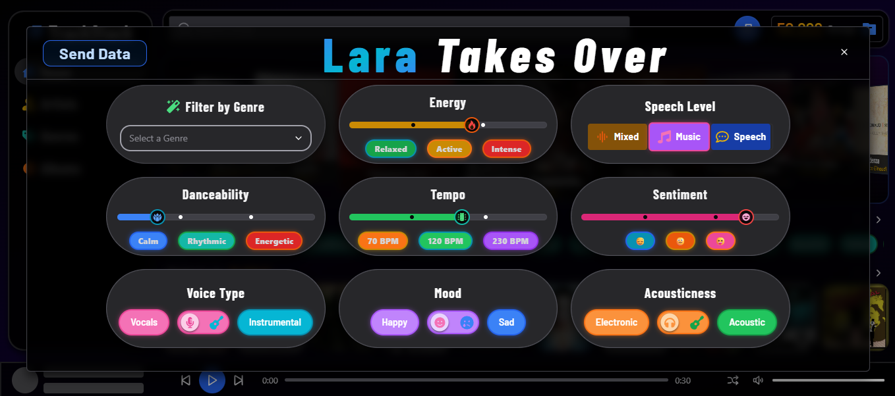
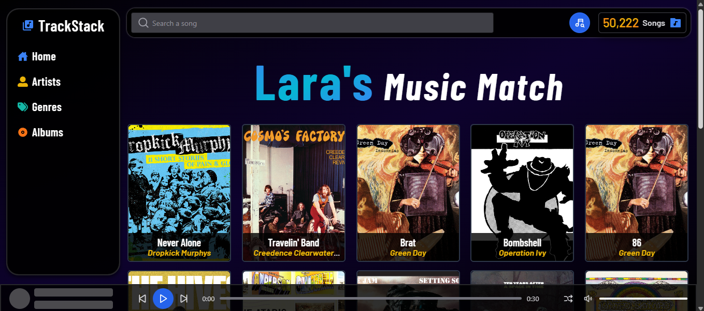
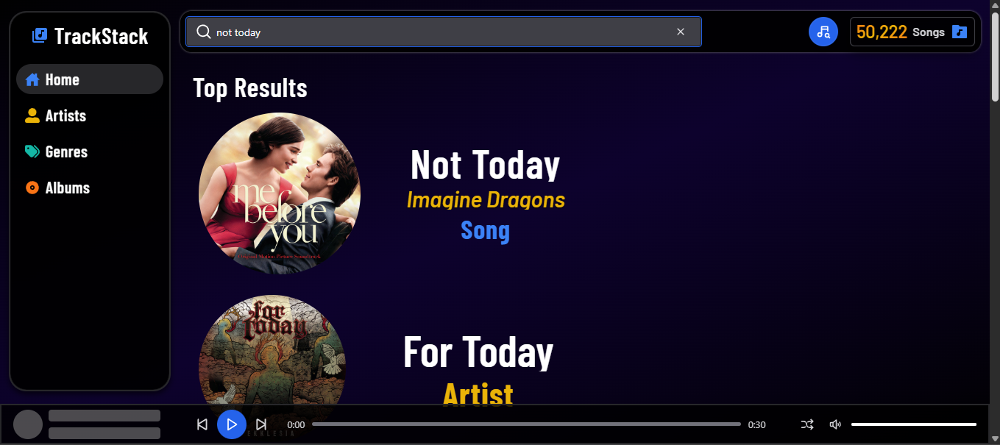
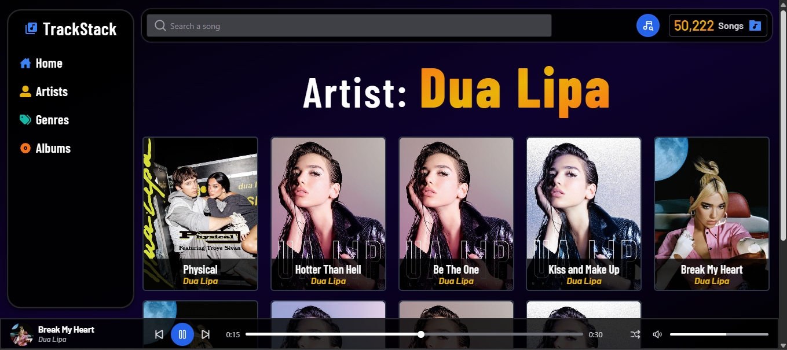
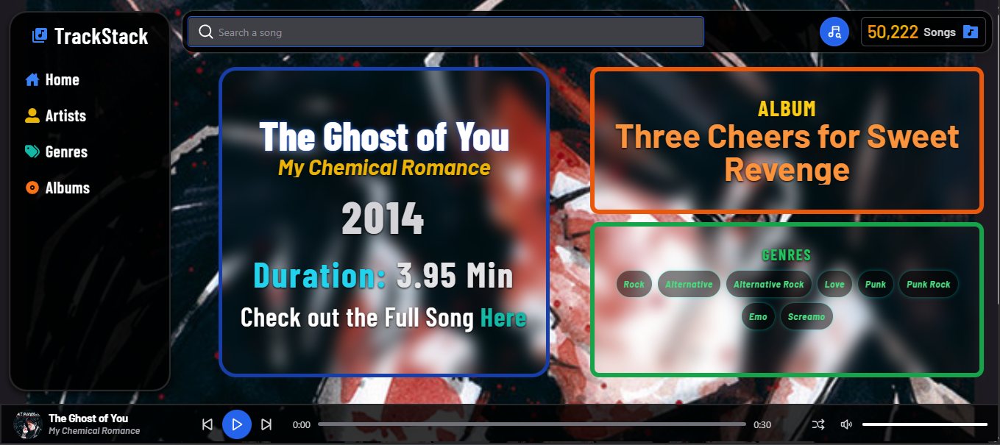
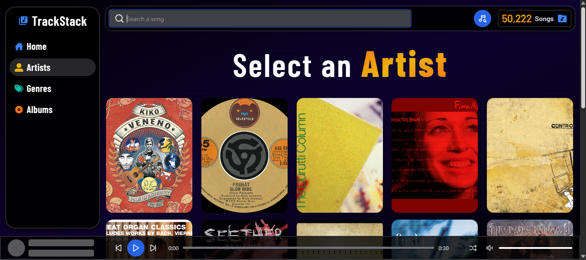
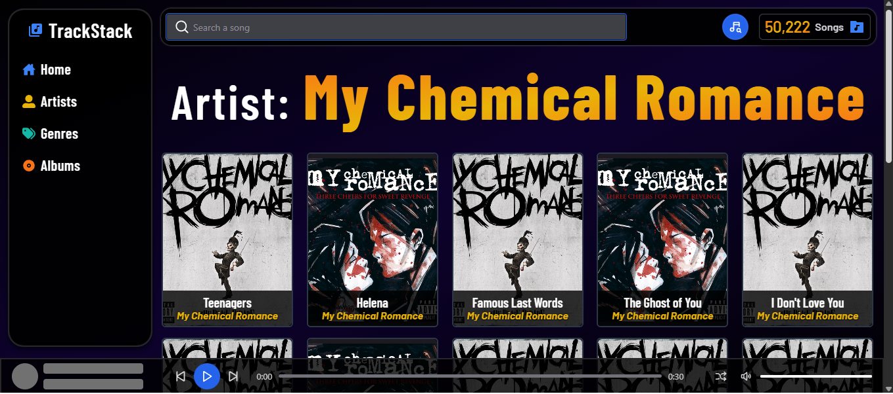
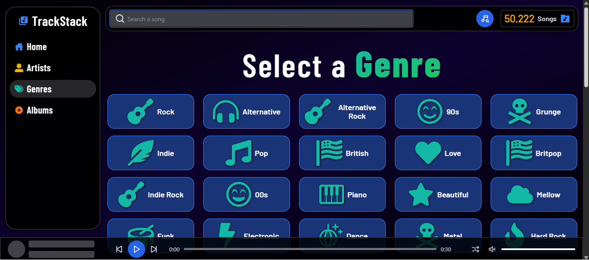
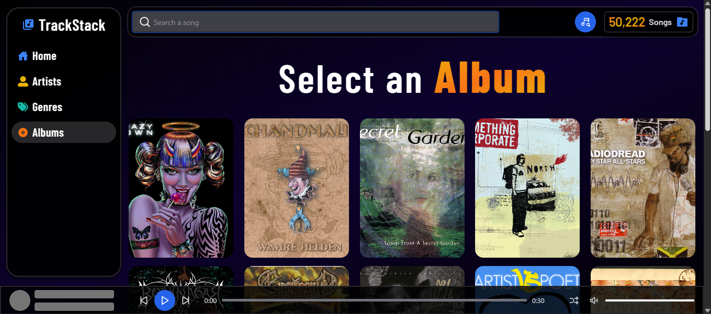
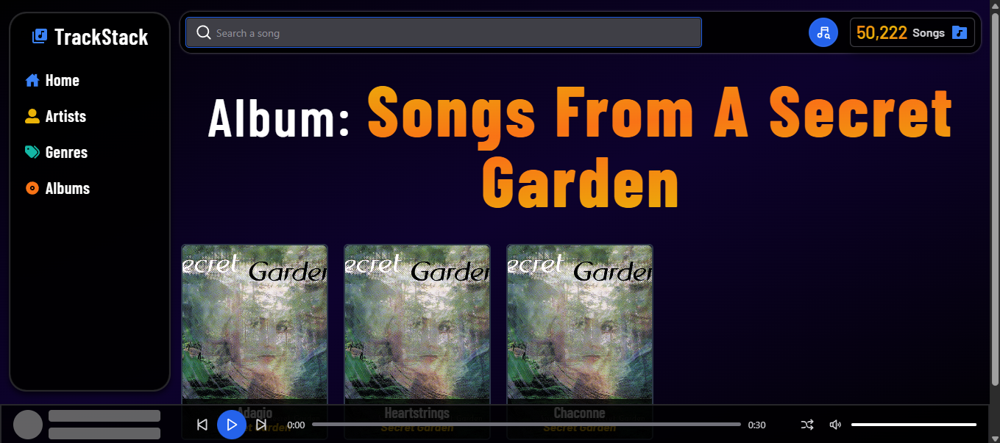

# Frontend — Features

This page walks through what a user can do in TrackStack, feature by feature. Try it on the [live demo](https://trackstack-c9rh.onrender.com/) (it may take about a minute to wake up).

## Get personalized recommendations

1. Open the recommendation modal with the **beam note** button in the top-right corner: the round blue button with a music-and-magnifier icon, next to the song counter, whose tooltip reads "Get personalized AI picks".
2. Pick one or more genres and adjust the sliders and switches (energy, danceability, mood, sentiment, tempo, and more).
3. Press **Send Data**. The app builds a weighted vector, requests the matching songs, and streams an AI description of the selection.

    

    

The resulting page shows the matching songs plus AI's answer, which streams in as it is generated. The vector weights and the subscription behind that streaming are described in [Architecture — How the recommendation vector is built](./architecture.md#how-the-recommendation-vector-is-built) and [Architecture — Stream the AI answer over a WebSocket subscription](./architecture.md#stream-the-ai-answer-over-a-websocket-subscription).

If no song matches the chosen filters, a toast suggests adjusting the options and the app stays on the current page. A failed request shows a "Something went wrong" toast instead of navigating away. If the AI subscription drops, the songs remain visible and the answer area shows "We couldn't load Lara's recommendations right now. Please try again later." alongside a single toast, so the page never waits forever.

## Search songs, artists, and albums

The search bar in the top navbar sends the query to `multipleSearch` and shows exact matches plus the remaining fuzzy results, all served by the backend's PostgreSQL search. Matching is accent- and case-insensitive: a typo such as `beatls` still finds "The Beatles" through trigram similarity, ranked below exact or prefix matches. Results are debounced, and the app ignores stale responses when a new query arrives.

    

- If nothing matches, the results area shows "No Data found...".
- If the request fails or returns an unexpected payload, it shows "Search unavailable" or "Search results unavailable" instead, and one toast explains the problem without stacking on retries.

See [Architecture — Data layer](./architecture.md#data-layer) for the search statuses and [Architecture — Error handling](./architecture.md#error-handling) for the toast policy.

## Listen to 30-second previews

Hover over a song cover and press play. The player at the bottom shows the current track and elapsed time, and includes random, previous, next, and volume controls.

    

Previews are 30-second clips hosted by Spotify (`url_preview`). If a song has no playable preview or the URL is not a valid `http(s)` URL, clicking play still makes it the active track, but the client clears the audio source, so nothing is played and the track stays silent. The audio source and play/pause handling live in `useSongState`; see [Architecture — Data layer](./architecture.md#data-layer) for the Redux playback state.

## Explore track details

Clicking a song title opens its detail page with artists, genres, duration, release year, album, and a link to Spotify.

    

An unknown or malformed song id shows a "not found" warning instead of an empty page. See the `/songs/:songId` entry in [Architecture — Routes](./architecture.md#routes) and the page-specific states under [Architecture — Error handling](./architecture.md#error-handling).

## Browse artists, genres, and albums

The left sidebar links to the artist, genre, and album catalogues. Each catalogue supports infinite scrolling, and every card opens the corresponding detail page.

    

    

    

    

    

If an artist, album, or genre detail page receives an unknown value or returns no songs, it shows a "not found" message rather than an empty layout. Infinite scrolling relies on the Apollo `merge` policies described in [Architecture — Data layer](./architecture.md#data-layer).